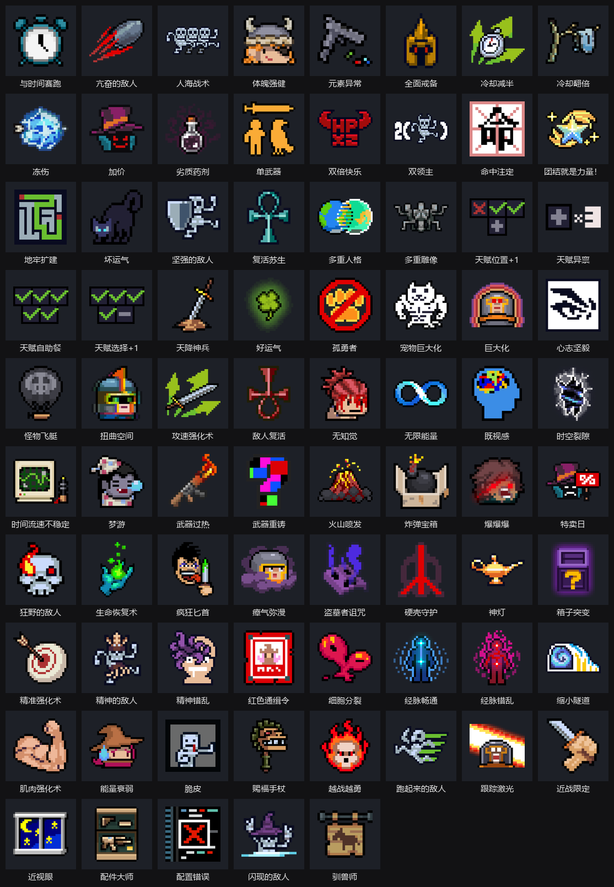

# 元气骑士 · 挑战因子自动刷新器

联机房间设置界面里那个 `⟳` 刷新按钮，帮你**一直点**，直到刷出你想要的因子组合为止。

纯界面自动化：截图 → 找刷新按钮 → 识别 4 个格子里的因子 → 符合就停、不符合就点。**不碰内存、不改存档、不注入游戏进程**，就是一个会看图的自动点击器。



## 它解决什么问题

联机模式里挑战因子可以无限刷新，但手点很烦——想刷「双领主 + 好运气」这种组合，期望要 140 多次。这个 App 替你点，刷到了会响铃 + 震动 + 停手。

## 功能

| 功能 | 说明 |
|---|---|
| 可视化选因子 | 4 列图标网格，点一下加入「要的」（绿框），换模式点一下加入「不要的」（红框） |
| 双名单 | 必须全部命中「要的」，且「不要的」一个都不能出现 |
| 组合规则校验 | 内置 wiki 的 17 种合法组合 + 11 组互斥对，选到不可能的组合会直接告诉你原因，不浪费电 |
| 悬浮窗 | 可拖动，显示进度/速率/耗时，自带「开始」「停止」按钮 |
| 计时器 | 第一行走秒 `03:24`，停下或刷到都显示总用时 |
| 因子介绍 | **长按**任意图标弹出简介（内置离线文本），右上角可跳 wiki |
| 刷不到的因子隔离 | 周挑战 8 个 + 特殊 10 个默认隐藏，避免误选空跑 |
| 自适应等待 | 按画面变化动态调等待时间（90~800ms），不靠固定 sleep，稳定 4~5 轮/秒 |
| 调试 | 每 200 轮存一张 debug.png（标注定位到的按钮和格子），刷偏了可据此校准 |

## 安装

从 [apk/](apk/) 拿 `soulknight-factor-roller-v2.0.apk` 装到手机上（Android 11 / API 30 及以上）。

签名证书指纹 SHA-256：`a2745a527a77ff04580d8261f2a7d17f1eed1fb4c888b6ad408778006990b3a8`

## 使用

1. 打开 App，允许**悬浮窗**权限；到系统设置里开启**无障碍服务**「元气刷因子」
2. 点 `① 选「要的」` → 点图标选目标（可多选）
3. 需要排除某些因子就切到 `② 选「不要的」`
4. 点「显示悬浮窗」→ App 自动退到后台
5. 进游戏，停在**联机房间设置界面**（能看到 4 个因子和 `⟳` 按钮那一屏）
6. 点悬浮窗上的「开始」，等它响

刷到了：响铃 + 震动 + 显示轮数、用时、最高分。想停就点「停止」。

## 原理

**找刷新按钮**：全屏灰度 + 8 倍块平均降采样，用 NCC（归一化互相关）在 5 个尺度上滑窗粗定位 `⟳` 图标，再映射回全分辨率。

**定位 4 个格子**：不硬编码坐标，由按钮几何推导——

```
pitch   = 1.404 × bw      // 格子间距，bw = ⟳ 图标宽度
tile    = 0.9  × bw       // 格子边长
tileCy  = btnCy - 1.382 × bw
centers = cx + pitch × (i - 1.5)   // i = 1..4
```

这样换手机、换分辨率都不用改代码，只要刷新按钮认得出来。

**识别因子**：77 张 wiki 精灵图按 bbox 紧裁存入 `icons.dat`，匹配时把模板缩放到格子的 0.75 / 0.90 / 1.05 三个变体，同样用 NCC 打分，取最大值；超过阈值 0.72 就认为是它。

**判定**：每格打分 → `found` 集合 ⊇ `want` 且 `avoid ∩ found = ∅` 才算命中。

**合法性**：wiki 规定联机 4 格只能是 17 种组合之一，且 11 组因子互斥。`whyNot()` 会先用互斥对排除，再把「因子→格子」的所有分配方式枚举一遍去匹配组合表。

## 期望刷新次数

17 种组合等概率、类别池内等概率、同类两格不重复的模型下 `E = 1/P`：

| 目标 | 概率 | 期望次数 |
|---|---|---|
| 单独一个好运气 | 9.24% | 10.8 |
| 双领主 + 无限能量 | 1.09% | 91.8 |
| 双领主 + 好运气 | 0.70% | 142.8 |
| 好运气 + 无限能量 | 0.47% | 214.2 |
| 双领主 + 好运气 + 无限能量 | 0.047% | 2142 |

自己算任意组合：`python tools/expect.py`

## 构建

不需要 Gradle，也不需要 Android Studio，手工调用 SDK 工具链即可（这样仓库里没有一堆构建配置，clone 下来就能看懂每个产物怎么来的）。

需要：**JDK 17** + **Android SDK platform 34 / build-tools 34.0.0**。

```powershell
# 方式一：把 JDK 和 SDK 目录告诉脚本
powershell -ExecutionPolicy Bypass -File build\build.ps1 `
    -Jdk  "C:\path\to\jdk-17" `
    -Sdk  "C:\path\to\android-sdk"

# 方式二：设环境变量 JAVA_HOME / ANDROID_HOME（脚本会自动用）
powershell -ExecutionPolicy Bypass -File build\build.ps1
```

流水线：`aapt2 compile` → `aapt2 link` → `javac` → `d8` → 把 classes.dex 塞回 APK → `zipalign` → `apksigner`。

产物：`build\out\signed.apk`。

> Windows 上 `build.ps1` 里的 Copy-Item 不要写成中文文件名，PowerShell 5.1 按 ANSI 读脚本会报 `Illegal characters in path`，复制动作交给调用方做。

## 目录

```
app/
  AndroidManifest.xml
  src/com/yqqs/factor/
    MainActivity.java    主界面：网格选因子、权限、悬浮窗唤起
    FactorService.java   无障碍服务：循环、悬浮窗、截图、点击
    Matcher.java         灰度化、降采样、NCC、按钮/格子定位
    IconPack.java        单文件图标包 icons.dat 的读取
  res/                   布局资源、无障碍配置、图标
  assets/
    factors.txt          77 个因子：id|名称|类别|简介
    icons.dat            77 张图标（自描述二进制格式）
    refresh.png          刷新按钮模板
build/build.ps1          手工构建脚本
tools/                   wiki 抓取、模板生成、期望值计算等辅助脚本
docs/                    图鉴、索引、使用说明
apk/                     已编译签名的 APK
```

## 已知限制

- 只适配**横屏**联机房间设置界面；其它界面找不到 `⟳` 会直接报错退出
- 截图走 `AccessibilityService.takeScreenshot()`，所以必须 API 30+
- 跨设备通用性依赖「刷新按钮能认出来」，不同 UI 缩放（如 2K 屏）若匹配失败，用「测试定位」存 debug.png 看偏差
- 悬浮窗与游戏画面层级冲突时，部分机型需要手动允许「后台弹出界面」

## 免责声明

仅供学习与个人使用。这是纯客户端界面自动化，不修改游戏数据、不联网、不注入进程。使用第三方自动化工具是否违反游戏用户协议由使用者自行判断并承担风险。

## 数据来源

因子图标、名称、类别、简介与组合规则均来自 [元气骑士中文维基](https://yqqs.huijiwiki.com/wiki/挑战因子)。